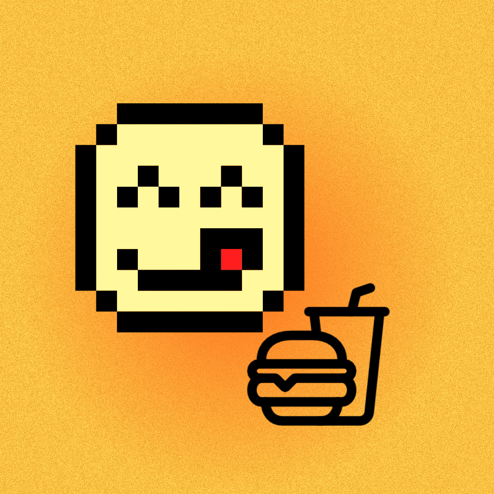

# Budget Bites



Budget Bites helps us keep track of food and drink money around campus. We use it to check what is left before buying, plan things for today, and see where the money went.

## The screens

- Home shows weekly money left, today's spending, favorite places, and a small daily spending suggestion.
- Activity has the daily budget and a checklist. A planned item only changes the totals after it is confirmed.
- Log has three ways to add something: a saved item, a new item, or an item from a saved place menu.
- History has a bar chart and the confirmed purchase list. The list can be filtered by category.
- Settings saves the profile, campus, budgets, optional nutrition goals, favorite places, and saved items.

## Saving data

The app works with local data on the phone. SQLite has two tables: `food_items` for reusable items and `purchases` for each planned or confirmed entry. A purchase can point to a saved food item, but it also keeps its own name, store, price, category, note, and date so the old history still makes sense if an item gets deleted. SharedPreferences stores the profile and settings. App data is not stored in a cloud service.

Category is suggested from words in the item name, then the user can see it before saving. The saved menu only shows items added by the user. It is not a live restaurant menu. Nutrition goals can be saved, but nutrition totals are not counted because the current food records do not have nutrition values. The notification switch saves the preference, but reminder scheduling is not connected yet. Location is typed by the user, not read from GPS.

The daily suggestion is a simple rule: divide the remaining weekly budget across the days left in the week, then do not suggest more than the daily budget setting. It can be changed in Settings or Activity.

## Run it

Install Flutter and an Android emulator or phone, then run:

```sh
flutter pub get
flutter run
```

The app was made for Android first. We are still building and checking the screens and data flows.
